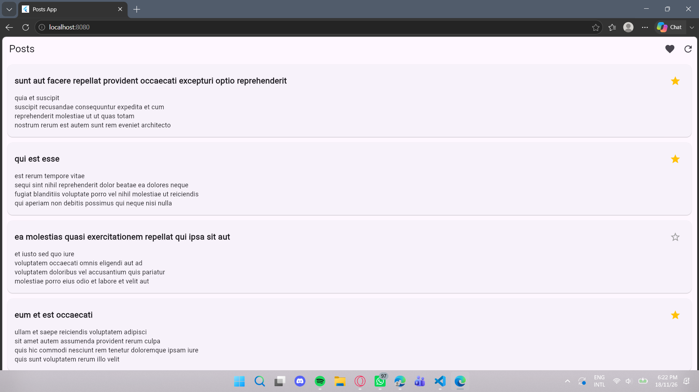
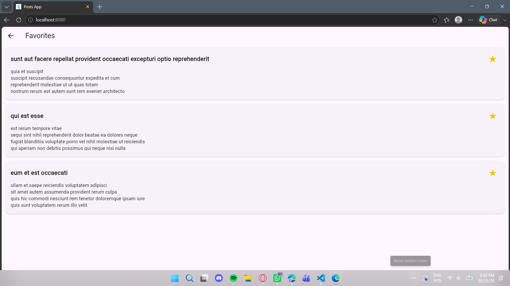
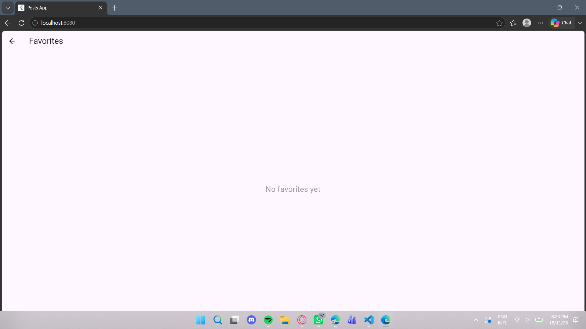
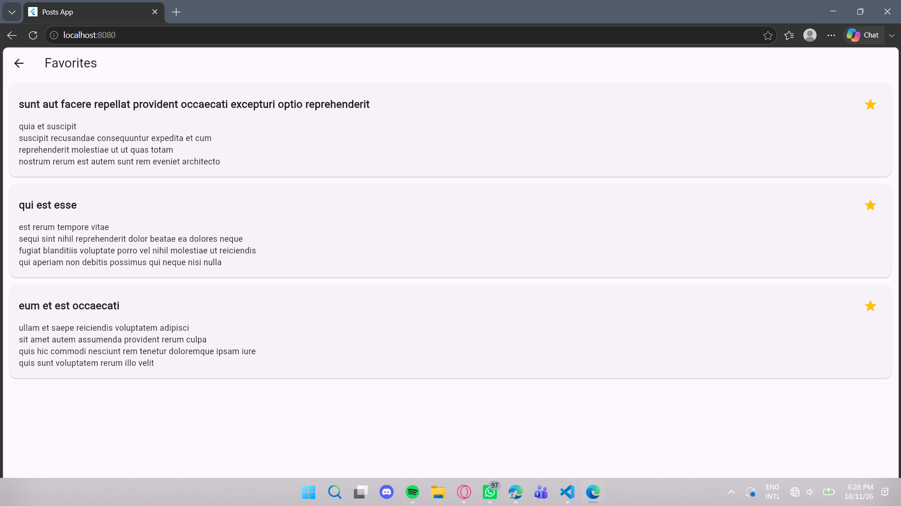

# Flutter Posts App - Favorites Feature

## Overview
A Flutter application that fetches posts from JSONPlaceholder and allows users to save their favorite posts using Hive local storage.

## Features
- Fetch and display posts.
- Add and remove favorite posts.
- Filled and outlined star icons.
- Separate Favorites screen.
- Empty favorites message.
- Persistent local storage using Hive.
- Offline access to saved favorites.

## Technologies
- Flutter
- Dart
- Hive
- Hive Flutter
- HTTP
- JSONPlaceholder API

## Screenshots

### Posts Screen

### Favorites Screen

### Empty Favorites

### Offline Favorites

## Local Storage
The application uses two separate Hive boxes:

- `postsBox`: Stores fetched posts.
- `favoritesBox`: Stores favorite posts independently.

Favorites remain available after restarting the application and can be accessed offline.

## How to Run

1. Clone this repository.
2. Run `flutter pub get`.
3. Run `flutter run`.

## Author
Mesk